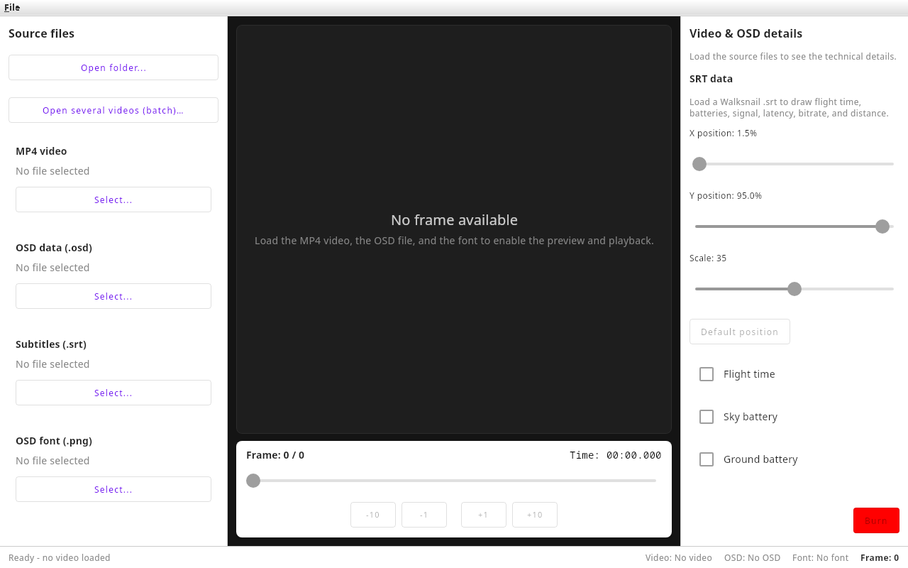
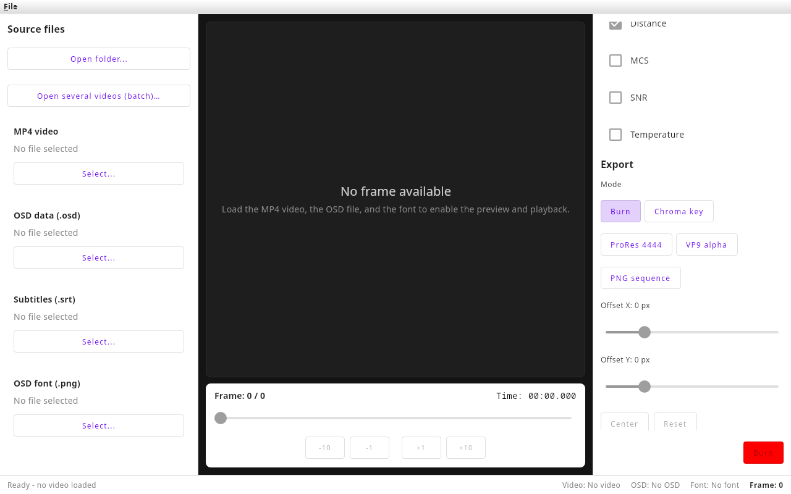

# Walksnail OSD

[](https://github.com/Grogdunn/kwalksnail-osd/actions/workflows/ci.yml) [](https://github.com/Grogdunn/kwalksnail-osd/actions/workflows/release.yml) [](https://github.com/Grogdunn/kwalksnail-osd/releases/latest) [](LICENSE) [](https://github.com/sponsors/Grogdunn) [](https://ko-fi.com/Grogdunn)

Walksnail OSD is a desktop app that draws the flight-controller OSD from a Walksnail Avatar DVR onto the recorded video.

It replaces [Walksnail OSD Tool](https://github.com/avsaase/walksnail-osd-tool) by Alexander van Saase and the other authors of that project. The last release is [v0.3.0](https://github.com/avsaase/walksnail-osd-tool/releases/tag/v0.3.0) (23 March 2024), and the project is no longer maintained. This app reads the same DVR files. The OSD format, the PNG font atlas, and the placement of glyphs on a frame follow that tool, and both projects are licensed under the GNU GPL version 3. See [Credits](#credits) and [NOTICE](NOTICE).

This project is independent of Walksnail and Caddx.

## What the app does today

- Opens a Walksnail DVR `.mp4`, the matching `.osd`, and a PNG OSD font.
- Fills in files that share the same name in the same folder.
- Opens a folder of clips, or several MP4s, and burns them joined or one file each.
- Draws the OSD on the video frame you select.
- Shows the video resolution, frame rate, frame count, duration, and codec.
- Shows the flight-controller tag, the number of OSD frames, and the OSD duration.
- Writes a new MP4 with the OSD drawn into the frames, and keeps the audio.
- Draws the Walksnail `.srt` fields you choose on the preview and on the burned video. Caddx Ascent lines and Avatar debug lines are read too.
- Exports the OSD on its own: chroma key, ProRes 4444, VP9 with alpha, or a PNG sequence.
- Follows the system language. The interface is available in English, Italian, Spanish, German, and French.

The downloadable builds include a Java runtime and the FFmpeg libraries used to read the video and to write H.264. You do not install Java. H.265 export needs an `ffmpeg` on your PATH that includes `libx265`. The bundled libraries do not include that encoder.

Bring your own PNG OSD font. Use the font atlas from the aircraft, the same kind of PNG that Betaflight, INAV, and similar tools export. This app does not ship one.

English is the fallback when the system language is not one of those five.

## Burn

**Burn** reads the MP4, draws the OSD on each frame at the `.osd` timestamp, and writes `{name}_with_osd.mp4`. Audio is copied when the source has any.

Choose H.264 or H.265 and a bitrate from 1 to 80 Mbps. **Encoder** offers Automatic, Software, or one hardware encoder that has already encoded a short test clip on this machine. Automatic uses the first hardware encoder that passes that test, and otherwise the software encoder. The test result is cached until the app exits. If the chosen hardware encoder fails while opening or while writing the file, Burn retries with the software encoder, writes that in the window, and logs it. A progress bar and **Cancel** stay on screen, and the window does not freeze. The labels follow the system language.

Only encoders compiled into the ffmpeg Burn actually runs are offered, and only after the test encode succeeds. A name in `ffmpeg -encoders` is not enough: a missing driver or a missing GPU drops the encoder.

The packaged JavaCV build is `org.bytedeco:ffmpeg:8.1.2-1.5.14` without the `gpl` classifier. Checked against the published jars:

- Linux x86_64, by running the binary: NVIDIA NVENC (`h264_nvenc`, `hevc_nvenc`), VAAPI (`h264_vaapi`, `hevc_vaapi`, libva is in the jar), and Intel QSV (`h264_qsv`, `hevc_qsv`). QSV loads Intel's `libmfxhw64.so.1` at runtime, which the jar does not ship. VAAPI needs a render node such as `/dev/dri/renderD128` and uploads frames with `format=nv12,hwupload`. NVENC needs the NVIDIA driver (`libcuda.so.1` and `libnvidia-encode.so.1`) and takes `nv12`.
- Windows x86_64, from the strings in `avcodec-62.dll`: NVENC and QSV. No VAAPI and no VideoToolbox.
- macOS arm64, from the strings in `libavcodec.62.dylib`: Apple VideoToolbox (`h264_videotoolbox`, `hevc_videotoolbox`). No NVENC, QSV, or VAAPI.

AMD AMF (`h264_amf`, `hevc_amf`) is not in any of those JavaCV builds, and it is not in Ubuntu's ffmpeg either. Burn still knows the AMF command line, but the button appears only when the ffmpeg selected for that codec lists the encoder and the test encode works. That is a third-party ffmpeg on `PATH` which also has `libx264` or `libx265`, because that binary is preferred to the JavaCV one. On Linux, AMD and Intel GPUs go through VAAPI, not AMF. The Linux JavaCV build also contains V4L2 mem2mem and Vulkan encoders; Burn does not offer them.

Hardware bitrate follows the slider. NVENC uses VBR with that bitrate as the cap, preset `p4`, and tune `hq`. VAAPI uses VBR. QSV and VideoToolbox use the bitrate directly (VideoToolbox with constant bitrate and hardware only, `-allow_sw 0`). AMF, when present, uses peak-constrained VBR. H.264 hardware asks for the High profile. HEVC hardware tags the file `hvc1`. Software stays `yuv420p` with the same bitrate flag as before.

Offset X and Y move the OSD in pixels. **Center** frames the glyphs of the current preview frame. With playback correction on, for Walksnail firmware up to 32.37.10, OSD timestamps are scaled by `video duration / OSD duration`.

The encoder is the `ffmpeg` binary from the JavaCV native libraries, the same binary the app images ship. If that binary does not start, the app uses `ffmpeg` on `PATH`. If neither runs, Burn says how to fix it.

For H.264 the app prefers `libx264` when the chosen binary has it, and otherwise uses `libopenh264` from the JavaCV build. OpenH264 follows the requested bitrate less closely. H.265 needs `libx265`. The hardware encoders above are probed on that same binary. If H.264 is written by the JavaCV binary and H.265 by an ffmpeg on `PATH`, each one is probed on its own.

## Several clips

**Open folder...** lists every `.mp4` in that folder. The `.osd` and the `.srt` with the same name are attached to each clip. **Open several videos (batch)…** does the same for the files you pick, including files from more than one folder. Reorder the list, exclude a clip, or restore A→Z order. The total duration counts the clips that stay included.

**Join into one video** writes `<first>_joined.mp4`. The included clips need the same frame rate. If the sizes differ, **Adapt different resolutions** is on by default: each clip is scaled to the first included clip, keeping the aspect ratio, and the empty space is black. The OSD is drawn on that target frame. Turn the option off and Burn stays disabled until every included clip has the same size. A clip uses the global offset, or its own offset when **Own OSD offset** is checked. Audio is AAC. A clip with no audio, or with audio shorter than the picture, gets silence for the missing part.

**Convert each separately** writes `<name>_with_osd.mp4` for each included clip into a folder you choose. An existing file, or another clip with the same name, is named `_2`, `_3`, and so on. A clip that fails does not stop the others. Cancel keeps the files that already finished. Different sizes and frame rates are allowed, because each file is independent.

## OSD only

The mode row sits above the codec. **Burn** writes the video with the OSD on it. The other modes draw the OSD on an empty frame for the length of the open video, or of the first included clip when a folder is open. Batch mode does not offer this export.

- **Chroma key** fills the frame with a color you choose. Magenta is the default. Glyphs and the SRT line are drawn with hard edges, so a keyer can drop the background.
- **ProRes 4444** writes a `.mov` with an alpha channel.
- **VP9 alpha** writes a `.webm` with an alpha channel.
- **PNG sequence** writes `osd_000001.png` and the following frames, with alpha, into a folder. The app estimates the size from the raw frame and asks before writing.

## SRT overlay

A Walksnail `.srt` adds flight time, sky and ground battery, signal, latency, bitrate, and distance to the preview and to the burned video. Caddx Ascent files use `Hz:` in place of `CH:`. Avatar debug files add MCS, ground and sky SNR, and temperatures. A debug file turns MCS and SNR on and turns signal, bitrate, and distance off. A file with no Walksnail or Caddx telemetry is rejected. Position is a percentage of the frame, from 0 to 100. Scale runs from 10 to 60 and is relative to a frame height of 1080. Each field can be hidden. Distance turns itself off when no cue reports a distance above zero.

The text is opaque light gray. Walksnail OSD Tool draws the same color with alpha 10. The vertical position is the top of the text.

## Screenshots

The main window with no video open. Source files are on the left, the empty preview is in the center, and the SRT controls are on the right.



The same window, scrolled to the export modes. Chroma key, ProRes 4444, VP9 alpha, and a PNG sequence sit next to Burn. MCS, SNR, and temperature are the debug SRT fields.



## Download

Download the zip for your system from [GitHub Releases](https://github.com/Grogdunn/kwalksnail-osd/releases). A release created from a `v*` tag starts as a draft. Download it from the release page once it is published. Tag names that produce a release look like `v1.2.3`.

These builds are not signed or notarized.

### Windows (x64)

1. Download `walksnail-osd-windows-x64.zip`.
2. Unzip it and open the `Walksnail-osd` folder.
3. Run `Walksnail-osd.exe`.

SmartScreen shows "Windows protected your PC" for this unsigned program. Choose **More info**, then **Run anyway**.

### macOS (Apple Silicon and Intel)

1. Download `walksnail-osd-macos-arm64.zip` on Apple Silicon, or `walksnail-osd-macos-x64.zip` on an Intel Mac.
2. Unzip it and open `Walksnail-osd.app`.

Gatekeeper blocks the unsigned app the first time. Control-click the app, choose **Open**, then **Open** again. The same approval is under **System Settings → Privacy & Security → Open Anyway**.

### Linux (x64)

1. Download `walksnail-osd-linux-x64.zip`.
2. Unzip it and open the `Walksnail-osd` folder.
3. Run `./bin/Walksnail-osd`.

The executable is not signed.

## Use the preview

1. Keep the DVR `.mp4` and the `.osd` file that Walksnail wrote beside it. Keep the original file names. An `.srt` file with the same name can sit in that folder too.
2. Start Walksnail OSD.
3. Open the `.mp4`. When the `.osd` and the `.srt` share that file name and that folder, the app selects them too.
4. Open the PNG OSD font.
5. Move the frame slider. The OSD for that moment is drawn on the frame.

You can also open each file from the **File** menu or from the file list. In English the menu entries are **Open MP4 video...**, **Open OSD file...**, **Open SRT subtitles...**, and **Open OSD font...**. Those labels follow the system language.

## Build from source

The project needs JDK 25.

Start the app:

```
./gradlew run
```

On Windows, run `gradlew.bat run`.

Build an app image for the machine you are on:

```
./gradlew createDistributable
```

On Windows, run `gradlew.bat createDistributable`.

## Support

If this project is useful, you can support the work on [Ko-fi](https://ko-fi.com/grogdunn) or [GitHub Sponsors](https://github.com/sponsors/Grogdunn).

## License

Walksnail OSD is free software under the GNU General Public License version 3 only. The full text is in [LICENSE](LICENSE).

Walksnail OSD Tool identifies the same license as `GPL-3.0` and does not grant a later version, so this project does not grant one either.

You may run, study, share, and modify this program. If you distribute a modified version, license that version under GPL-3.0 and keep the notices in [NOTICE](NOTICE).

The packaged FFmpeg libraries are a separate work. Builds include `org.bytedeco:ffmpeg:8.1.2-1.5.14` without the `gpl` classifier. That is Bytedeco's LGPL build of FFmpeg: it contains OpenH264 (`libopenh264`) and it does not contain `libx264` or `libx265`. Those libraries keep their own licenses. The GPL-3.0-only grant of this program does not replace them. Details are in [NOTICE](NOTICE).

## Credits

The OSD file reader, the PNG font-atlas reader, and the placement of glyphs on a frame are a Kotlin translation of the matching code in [Walksnail OSD Tool](https://github.com/avsaase/walksnail-osd-tool) (`backend/src/osd` and `backend/src/font`).

Walksnail OSD Tool is copyright its authors. The package metadata names [Alexander van Saase](https://github.com/avsaase) as the author. The Git history also records these contributors:

- [Maksym Motorny](https://github.com/mmotorny)
- [Janez Troha](https://github.com/dz0ny)
- [Marcelo Bezerra](https://github.com/mmosca)
- [Viacheslav Zhivetyev](https://github.com/vmzhivetyev)

Copyright (C) 2026 [Lorenzo Caenazzo](https://github.com/Grogdunn) for this repository, including the desktop UI, the video reader, and the packaging.

No font files, icons, or other media from Walksnail OSD Tool are included here.
